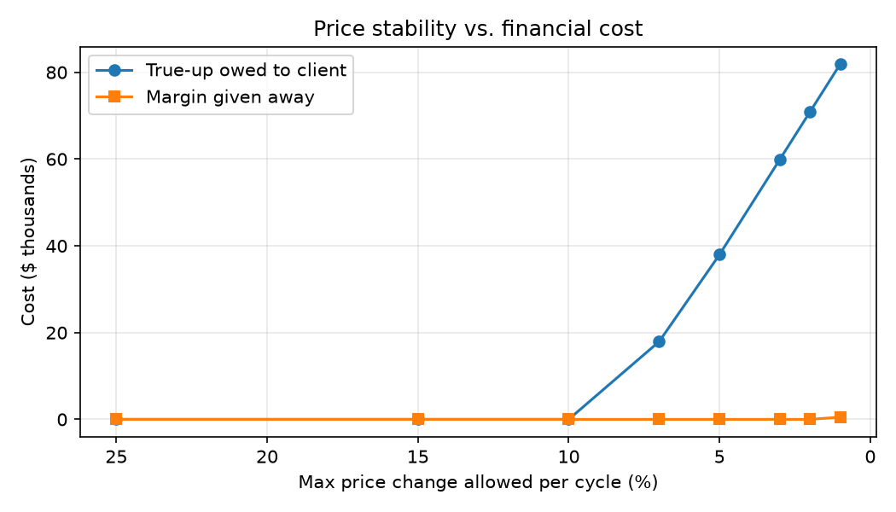
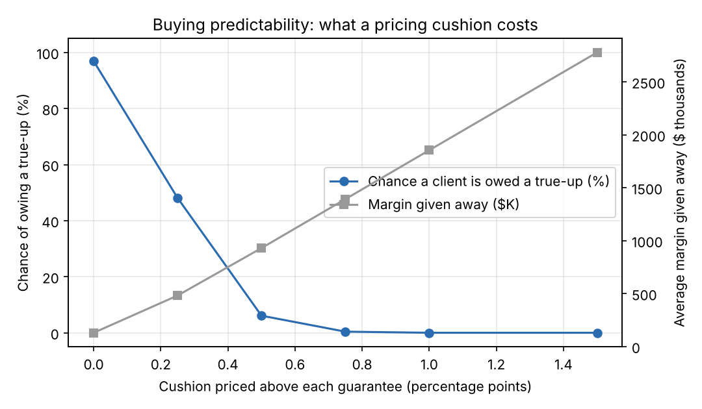

# MAC Pricing Optimizer

**Setting generic drug prices to meet a health plan client's pricing guarantees, using linear programming (Python + Gurobi).**

> Learning project, built September–November 2026 to understand PBM pricing-guarantee optimization.
> Part 2 uses **real** generic acquisition costs from the public CMS NADAC file. AWP, claim volumes, current prices and contract terms are **simulated** throughout. Nothing here reflects any real company's contracts or data.

---

## The business problem

A pharmacy benefit manager (PBM) serving a reseller health plan client promises **AWP discount guarantees**: for example, "generics at retail 30-day pharmacies will cost, on average, AWP minus 80%." Each pharmacy channel (retail 30-day, retail 90-day, mail) has its own target.

The PBM controls this through **MAC prices**, the maximum it pays per unit of each generic drug. Every pricing cycle, those prices have to be set so that:

- **The guarantee is met.** Missing it means paying the client a *true-up* for the shortfall.
- **It is not beaten by much.** Over-delivering gives away margin for nothing.
- **Pharmacies are paid at least their acquisition cost**, or the network suffers.
- **Prices don't swing wildly** between cycles.
- **Channels stay consistent.** A unit shouldn't cost more at mail order than at a retail pharmacy.

With hundreds of drugs across several channels, this is a constrained optimization problem.

## Results (200 simulated drugs, 3 channels)

Starting position with current prices:

| Channel | Guarantee | Current discount | Position |
|---|---|---|---|
| Retail 30 | 80.0% | 78.0% | **$78K true-up owed** |
| Retail 90 | 84.0% | 84.2% | $6K margin given away |
| Mail | 86.0% | 85.3% | **$12K true-up owed** |

After optimization with a ±15% price-change limit, **all three channels hit their guarantee exactly, with $0 true-up and $0 margin given away** on the planned volumes (see Limitations for what happens when volumes shift). This moved 101 of 600 prices. 10 prices had to be raised beyond the limit because they were below pharmacy acquisition cost.

### The key trade-off: price stability costs money



| Max price change per cycle | True-up owed | Prices changed |
|---|---|---|
| 15% | $0 | 101 |
| 10% | $0 | 228 |
| 7% | $17,934 | 342 |
| 5% | $37,964 | 412 |
| 2% | $70,872 | 454 |

**Takeaway:** down to about a 10% change limit, the guarantees can still be met at no cost. Below that, every point of added stability has a measurable dollar cost. This gives a business stakeholder a concrete basis for choosing the limit.

## Limitations (what a real system would add)

- Real AWP, utilization and contract terms. Real contracts also include brand guarantees, dispensing fees and rebates.
- **Utilization uncertainty.** Hitting each guarantee exactly is fragile. In a quick test, I let each drug's volume move randomly by about ±15% after repricing, and the "optimal" prices still owed a small true-up about 87% of the time. A next step is to optimize across several demand scenarios, or target a small cushion above the guarantee, and show what that safety costs in margin.
- Pharmacy-side network contracts, which have their own guarantees.
- Member cost-share impact.
- Thousands of drugs. The pip version of Gurobi has a size-limited license, so this demo uses 200.

Part 2 below takes on the first two of these.

---

# Part 2: one MAC list, many clients

Part 1 priced a single client. A real PBM pays pharmacies from **one MAC list**
that has to satisfy every client at once, each with its own drug mix and its own
guarantees. Part 2 rebuilds the problem that way, on **real acquisition costs**.

- **Costs are real:** 200 generic drugs from the CMS NADAC weekly file
  (`data/raw/nadac_sample.csv`, as of 2026-10-28) — real names, real
  `nadac_per_unit`, sampled across the cost range.
- **Still simulated:** AWP, claim volumes, current prices, client contracts.

**Decisions:** `p[drug, channel]`, the MAC price pharmacies are paid, and
`s[client, channel]`, the scale factor applied to that list to bill each client.

```bash
python run_book.py       # 200 drugs x 3 channels, 12 clients, 6,111 claim lines
```

### The joint problem is bilinear, so it is solved as two LPs

A client's spend is `sum(s * p * units)`, which multiplies two decision
variables. Rather than hand that to a nonlinear solver, the model alternates:

| step | held fixed | solved for | linear? |
|---|---|---|---|
| p-step | scale factors | the shared MAC list | yes |
| s-step | the MAC list | scale factors | yes |

Each step can only lower the same objective, which is bounded below by zero, so
it converges — here in **2–3 passes**. This finds a local optimum, not a proven
global one. The trade is deliberate: two exact LPs are easier to explain, debug
and hand over than one nonlinear model.

### Finding 1: one scale factor per client cannot work

| scale factors | guarantee pools missed | true-up owed | margin given away |
|---|---|---|---|
| one per client | **14 of 36** | $55,128 | $5,485 |
| one per client and channel | **0 of 36** | $0 | $0 |

A client has three channel guarantees. One factor is a single degree of freedom
aimed at three targets, so it lands on retail 30 and misses 90-day and mail.
Three factors per client hit all of them exactly. The cost is operational, not
mathematical: three times as many numbers to administer and audit.

### Finding 2: some contracts cannot be priced profitably at all

**6 of 12 clients are billed less than the pharmacies serving them are paid**,
$404,657 in total. Their guarantees are deeper than the cost of filling their
claims, so no MAC list fixes them. The model surfaces these as a
contract-negotiation finding instead of quietly absorbing the loss.

### Finding 3: exact-fit pricing is fragile, and the usual headline misleads

Volumes do not land on plan, and they do not move independently — a whole
therapeutic class shifts together. Scoring the chosen prices against 2,000
**correlated** volume scenarios (client x class x drug effects):

- **96.9%** of scenarios leave at least one pool owing a true-up
- average true-up **$125,358**, 95th percentile **$406,395**
- average margin given away **$129,594**

That 96.9% sounds alarming and mostly is not: with 36 pools each near a coin
flip, *something* almost always misses. The number that matters is dollars, and
they are concentrated — **one client carries 52% of the exposure**. Reporting
the probability alone would aim the team at the wrong problem.

### Finding 4: a cushion buys predictability at a poor exchange rate



Pricing a little above each guarantee, then scoring against the real ones:

| cushion | chance of a true-up | avg true-up | 95th pct | margin given away |
|---|---|---|---|---|
| 0 | 97% | $125,358 | $406,395 | $129,594 |
| 0.25 pt | 48% | $14,389 | $89,176 | $481,379 |
| 0.50 pt | 6% | $578 | $566 | $929,793 |
| 0.75 pt | 0% | $24 | $0 | $1,392,054 |
| 1.00 pt | 0% | $0 | $0 | $1,854,378 |

A quarter-point cushion removes **$111K** of expected true-up and costs
**$352K** of extra margin — roughly **$3 given up per $1 of exposure avoided**.
Aiming the cushion only at the riskiest pools did not help either: the exposure
sits with the *largest* client, and a cushion costs in proportion to a client's
spend while its benefit scales with the variance of that client's gap, which is
proportionally smaller for a big book. Cushions are worst value exactly where
the dollars are.

**What that argues for:** better volume forecasting on the few large pools, and
renegotiating the structurally unprofitable contracts — not a blanket cushion.
Whether to buy a cushion anyway is a business judgment about how much a surprise
true-up costs beyond its dollar amount. The table gives that conversation
numbers instead of adjectives.

### What Part 2 still leaves out

- **Mid-year re-pricing.** Guarantees run over a contract year; by month 7 the
  first 7 months are locked and only the rest can be steered. A year-to-date
  model is the natural next step.
- **Brand drugs, rebates, dispensing fees and specialty**, all of which sit in
  real contracts.
- **"Lesser of" logic** — many cheap generics actually pay at the pharmacy's
  cash price, which changes the effective rate.
- **Pharmacy-side guarantees** and per-network MAC lists (chain vs. independent).
- **Scale is capped by the licence.** The pip build of Gurobi is size-limited,
  so the book is 200 drugs and 12 clients rather than thousands.

> **Superseded by Part 3.** A reviewer pointed out that Part 2 lets the
> optimizer choose each client's billing multiplier. That is a lever no pricing
> analyst has mid-contract, and it is why Part 2 reports a perfect score. Part 2
> is kept as a baseline; Part 3 is the honest version.

---

# Part 3: contract-aware pricing under uncertainty

Part 2 could hit every guarantee because it was allowed to change what clients
were billed. Part 3 takes that lever away. The contract is an **input**:

| | |
|---|---|
| **Decided** | `p[drug, channel]` — the MAC price pharmacies are paid |
| **Fixed by contract** | every client's AWP discount guarantee, dispensing fees, admin fees |
| **Moved out of pricing** | billing multipliers, now a separate renewal question in `renegotiate.py` |

```bash
python run_v3.py     # 150 drugs x 3 channels, 12 clients, 4,614 claim lines
```

### The pass-through assumption, stated plainly

This model bills the client the same ingredient cost the pharmacy receives:

```
client ingredient charge = pharmacy ingredient reimbursement = MAC x units
client total charge      = ingredient + dispensing fee x scripts + admin fee x scripts
```

That is **a simplification, not an industry rule**. Real pass-through contracts
differ in how ingredient cost and fees are defined, and spread arrangements are
a different structure that is not modelled here. Fees are kept out of the
ingredient total throughout, because the guarantee is written against
ingredient cost alone.

### The economics this produces

Under pass-through the ingredient dollars flow through untouched, so:

```
PBM revenue      = admin fee x scripts      (independent of the MAC price)
PBM cost         = true-up payments         (depends on the MAC price)
contribution     = revenue - true-ups - operating cost
```

Two consequences worth stating, because both are easy to get wrong:

- **Over-delivering a discount is not a PBM expense.** A lower MAC means the
  pharmacy is paid less and the client pays less. Those dollars were never the
  PBM's. Part 2 subtracted them as "margin given away"; Part 3 reports them as
  **guarantee overperformance**, a client benefit, and never nets them against
  margin.
- **Admin-fee revenue cannot change the optimal prices**, since it does not
  depend on the MAC. It belongs in the P&L, not the objective.

So the only pricing-dependent **contract** cost is true-ups, which pushes
prices **down**, while the pharmacy reimbursement floor pushes them **up** and
the price-change limit stops either side moving far in one cycle.

That is true of the P&L but not of the objective: the solver also carries a
price-stability penalty worth about half the objective value. It is a non-cash
proxy rather than a contract cost, and Finding 4 gives the numbers.

### Finding 1: three guarantees are out of reach, and stability policy is why

Before any solving, the cheapest a pool can be billed is every price at its
lower bound, so comparing that to the guarantee settles reachability exactly.
But the lower bound is `max(pharmacy floor, last price × (1 − change limit))`,
and which of those two binds changes the answer entirely:

| | pools |
|---|---|
| feasible | **33 of 36** |
| unreachable **this cycle** — the ±15% price-change limit binds | **3 of 36** |
| infeasible on drug cost — the pharmacy floor binds | **0 of 36** |

All three are `mail` on the deepest tier (87.5%), short by 0.01–0.41 points, and
**$16,146 of true-up cannot be avoided in this cycle.** But on those pools only
about 8% of the cheapest possible spend sits on the pharmacy floor. Widen the
one-cycle change limit and the shortfall disappears:

| one-cycle change limit | pools short | unavoidable true-up |
|---|---|---|
| ±15% (current policy) | 3 | $16,146 |
| ±17% | 2 | $5,077 |
| ±20% | 0 | $0 |

So this is **not** a drug-economics problem. Every contract here is deliverable
once prices have time to get there; the constraint is how fast prices are
allowed to move. `renegotiate.py` reports the two cases separately, because the
remedies differ: a pool short on cost needs a new contract, a pool short on
stability needs another cycle or a looser limit.

Part 2 reported $0 here, because it could re-bill the client instead. That is
the substantive difference between the versions — though note it is $16,146
against a change-limit policy, not an unavoidable cost of the book.

### Finding 2: optimizing against uncertainty beats pricing on the plan

Scenarios go **inside** the objective (sample average approximation), not just
into a stress test afterwards. Trained on 15 correlated volume scenarios,
scored on 2,000 held out:

| strategy | mean true-up | 95th pct | CVaR 95% | mean contribution | P(negative year) |
|---|---|---|---|---|---|
| plan volumes only | $23,330 | $44,073 | $50,993 | $22,679 | 4.5% |
| **expected cost (SAA)** | **$17,270** | **$26,049** | **$30,174** | **$28,739** | **0.1%** |
| SAA + CVaR (w=0.5) | $17,288 | $26,094 | $30,255 | $28,721 | 0.1% |
| CVaR only (w=1.0) | $17,765 | $27,730 | $32,473 | $28,244 | 0.2% |

Pricing against scenarios cuts expected true-up by **26%** ($6,060) and the 95th
percentile by **41%**.

Contribution rises by **the same $6,060**, not by a further amount: admin fees
and operating costs do not depend on price, so `contribution = admin − true-up
− opcost` moves one-for-one with the true-up saved. It is one gain reported two
ways, and quoting both as separate improvements would double-count it.

### Finding 3: CVaR did not help here, and the reason matters

CVaR is implemented (Rockafellar–Uryasev, linearised) and it makes the result
slightly **worse** out of sample. That is not a bug. With 15 training
scenarios, a 0.80 tail rests on 3 points, so the CVaR term fits sampling noise
rather than real tail risk. At 0.95 it would rest on 0.75 of a scenario and
collapse to a minimax.

The honest conclusion at this sample size is to use expected cost. CVaR is
worth revisiting with a licence that allows enough scenarios to estimate a tail.
Reporting this rather than quietly dropping the code is the point.

### Finding 4: the settlement is recomputed independently

`src/reconcile.py` rebuilds the contract year from the claim lines — group the
claims, apply each guarantee, take the positive part — the way a finance team
would. It is compared against **the solver's own true-up decision variables**,
so the two calculations share only the price vector and the input data.

The check runs over **all 15 scenarios the model was solved on**, each against
its own volumes, and takes the worst disagreement: **$0.000000**. Checking only
the first scenario would leave most of the solver's variables untested, and
since the model trains on perturbed volumes, scenario 0 is not the planned
year — so that figure must not be read as validating the plan-volume P&L
below. It validates the solve.

An earlier version of this check compared price × units aggregated two
different ways, which could not really fail. A test now corrupts the price
vector and asserts the check *does* fail, so it is worth something.

### Exceptions to the price-change policy

The ±15% cap is not absolute: where the pharmacy cost floor sits above it, the
floor wins, because paying a pharmacy below acquisition cost is worse than a
larger price move. That is a deliberate choice and it should be counted, not
buried:

- **23 of 450 prices** breach the cap for this reason
- extra spend above the capped price on those rows: **$9,854**, 0.09% of ingredient cost
- largest single increase: **92.2%**

### The pharmacy floor is an assumption, so here is what it is worth

The floor is `NADAC × (1 + margin)`. NADAC is a national survey average, not
any pharmacy's contracted rate, and a real network would use negotiated terms,
lesser-of provisions and different schedules per network. `margin_floor` is a
parameter everywhere rather than a constant, and the answer moves with it:

| margin over NADAC | pools short | true-up (plan) | contribution | floor exceptions |
|---|---|---|---|---|
| 2% | 2 | $14,845 | $30,589 | 18 |
| **5% (default)** | **3** | **$16,146** | **$29,289** | **23** |
| 8% | 3 | $17,648 | $27,786 | 24 |
| 12% | 3 | $19,868 | $25,566 | 31 |

Contribution falls roughly $500 for each point added to the floor. Worth
knowing before quoting any single figure from this model as though it were
robust to that assumption.

**P&L on plan volumes** (one planned year, not an expectation):

| | |
|---|---|
| admin fee revenue | $82,935 |
| true-up payments | −$16,146 |
| operating cost | −$37,500 |
| **contribution margin** | **$29,289** |
| *(pass-through ingredient)* | *$11,513,486* |
| *(guarantee overperformance)* | *$1,006,993 — client benefit, not a PBM expense* |

Across the 2,000 held-out years those same prices give a mean true-up of
$17,270 and mean contribution of $28,739. The table above is the planned year;
in a section arguing against pricing on the plan, it would be careless not to
say which basis it uses.

**One term is not in the P&L and should be named.** The objective also carries
a price-stability penalty, `0.01 × Σ units × |p − p₀|`, worth $18,639 of the
$37,022 objective — about half of it, and larger than the expected-true-up
term. It is a non-cash proxy for the operational cost of repricing, not a
contract cost, so it is deliberately excluded from the P&L. It is doing real
work in the solution, though: 402 of 450 prices move, and the solver sits
against the ±15% boundary, which is also why Finding 1 comes out the way it
does. Calling it a tie-breaker, as Part 1 fairly could, would be wrong here.

### What changed from Part 2

| | Part 2 | Part 3 |
|---|---|---|
| Client billing multiplier | optimized, free in 0.85–1.15 | **fixed by contract**; renewal question moved to `renegotiate.py` |
| Guarantees met | 36 of 36, $0 true-up | 33 of 36; $16,146 short **against the ±15% change limit** |
| Uncertainty | measured after optimizing | **optimized against** (SAA, optional CVaR) |
| Over-delivery | subtracted as "margin given away" | reported as overperformance, **not** a cost |
| Financials | billed minus paid (spread) | admin revenue − true-ups − operating cost |
| Validation | price × units, two ways | solver's own true-up variables vs **independent settlement** |
| Test skipping | missing package only | missing package **or licence** (`tests/conftest.py`) |
| Synthetic fields | `klass` | `synthetic_class`, documented as a random label |

### What Part 3 still leaves out

- **Mid-year re-pricing.** Guarantees run over a contract year; by month 7 only
  the remaining months can be steered.
- **Multiple MAC lists and pharmacy networks.** Real PBMs maintain different
  schedules per network and programme. Deferred deliberately: it adds plumbing
  without changing any finding here.
- **Spread arrangements**, brand drugs, rebates, specialty, and "lesser of"
  logic against the pharmacy's cash price.
- **Cloud deployment.** The architecture is straightforward — claims in
  BigQuery, a scheduled solve, prices written back — but it is not built here,
  and describing it honestly beats a token implementation.
- **Scale.** The pip Gurobi licence caps the model at roughly 2,000 variables,
  which sets the 150 drugs × 12 clients × 15 scenarios used above.

---

## Technical details

### Formulation

For each drug *i* and channel *c*:

**Decision variable:** `p[i,c]`, the new unit price.

**Data:** `q` = units, `awp` = AWP per unit, `nadac` = acquisition cost, `p0` = current price, `g[c]` = guarantee.

**Objective:** minimize total dollar cost.

```
minimize   Σc shortfall[c] + Σc surplus[c] + 0.01 · Σ q · |p - p0|
```

The first two terms are real money. The third is a small tie-breaker that prefers fewer, smaller price changes.

**Constraints:**

| Constraint | Formula | Why |
|---|---|---|
| Guarantee | `Σi p·q − (1−g[c])·Σi awp·q = shortfall[c] − surplus[c]` | Measures the miss in dollars. Linear because the effective discount is total paid ÷ total AWP. |
| Pharmacy floor | `p ≥ nadac · 1.05` | Never pay below cost |
| Stability | `p0·(1−δ) ≤ p ≤ p0·(1+δ)` | Limit price swings (the floor wins if they conflict) |
| Channel order | `p[mail] ≤ p[retail_90] ≤ p[retail_30]` | Longer supply shouldn't cost more per unit |
| Absolute value | `p − p0 = up − down`, with `up, down ≥ 0` | Keeps `\|p − p0\|` linear |

Size: 1,806 variables and 1,003 constraints. It solves in well under a second.

If the model is infeasible, it computes an IIS (Irreducible Inconsistent Subsystem) and reports which constraints conflict.

### Project structure

```
src/config.py      business assumptions (guarantees, limits, weights)
src/data.py        NADAC loader + simulated AWP, claims, current prices
src/model.py       Part 1: Gurobi LP for one client
src/report.py      channel summary, trade-off sweep, chart
run.py             Part 1 pipeline

src/book.py        Part 2/3: real NADAC costs + a book of clients
src/model_multi.py Part 2: shared MAC list + per-client scale factors (two LPs)
src/risk.py        correlated volume scenarios, cushion sweep, chart
run_book.py        Part 2 pipeline

src/contract.py    Part 3: fixed contract terms, pass-through, fee structure
src/model_v3.py    Part 3: MAC-only optimization, SAA + optional CVaR
src/reconcile.py   Part 3: settlement and P&L rebuilt from claims, plus the
                   one function that deliberately reads the solver, to check it
src/renegotiate.py Part 3: renewal questions, kept out of pricing
run_v3.py          Part 3 pipeline

data/raw/          real CMS NADAC sample (2026-10-28)
tests/             pytest checks on both models' guarantees and constraints
.github/           CI: tests run on every push
```

### Run it

```bash
pip install -r requirements.txt
python run.py                              # Part 1: one client, simulated costs
python run.py --nadac data/raw/nadac.csv   # Part 1 with a full CMS NADAC download
python run_book.py                         # Part 2: 12 clients, real NADAC costs
python run_v3.py                           # Part 3: contract fixed, uncertainty optimized
pytest -q                                  # 35 tests; skipped cleanly with no Gurobi or no licence
```

To use real costs, download a NADAC CSV from data.medicaid.gov (search "NADAC") and save it as `data/raw/nadac.csv`. The loader keeps generic drugs and the latest price per NDC.

### Tests

The tests check that the model:
- hits every guarantee when limits are loose,
- never prices below the pharmacy floor,
- respects the price-change limit (except floor-forced rows),
- keeps channel price order,
- never gets cheaper as limits tighten.
